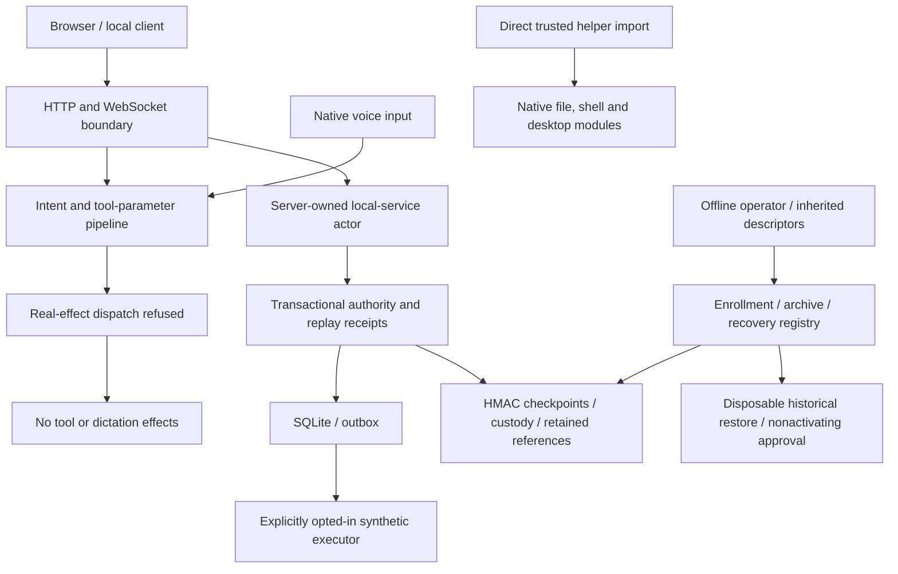
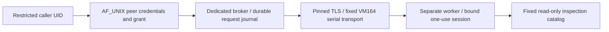

# Threat model and trust boundaries

This is a single-operator assistant, not a multi-user SaaS. Separate trust domains are nevertheless relevant: foreign browser origins, other local OS UIDs without the service credential, the authenticated operator, untrusted artifact/filesystem inputs, model/provider responses, protected storage custodians, and proposed restricted broker/worker identities. Same-UID control of the process, its keys or database is explicitly trusted; root/kernel compromise and coordinated rollback of all external custody are outside the local integrity contract.

In snapshot-packaged, server intent processing, every registry dispatch/getter and dictation independently refuse real effects. The confirmation endpoint is removed. Remaining direct native helpers require a trusted independent caller; earlier live-chat fixture results do not establish current reachability. Synthetic execution remains separately opted in and bounded.

| Boundary | Source-visible control and scope | Required external assumption |
|---|---|---|
| Client -> HTTP | Configured Bearer token; ordinary routes bypass it when empty. Operator diagnostics independently requires a configured matching token. Bind/CORS validation is in configuration. | Actual admitted startup, listener/ingress and OS-principal reachability; loopback is not user identity. |
| Browser -> WebSocket | Both paths validate present Origin before accept and configured token from Authorization; native clients may omit Origin. Clients render untrusted text with textContent. | Browser local-network policy, actual client packaging, transport and configured origins. |
| API -> authority | Fixed server actor; scope checks; bounded strict submissions; durable request/payload/operation receipts; internal phase identities. | Application authentication must establish the client trust boundary before assigning the service actor. |
| Authority -> SQLite | Lifetime flock, owner generation, PID and inode fencing, FULL transactions, poisoned uncertain writers and UNKNOWN preservation. | Private storage/ancestors and supported local filesystem/SQLite behavior. |
| SQLite -> protected ledger | Canonical logical-state digest, authenticated append-only intents/finals, fresh-byte cache hashes, continuity and retained epoch ancestry. | Independent key, anchor and minimum-reference custody and trustworthy time. HMAC is shared-key authentication. |
| Scheduler/outbox -> executor | Stable occurrence identities; final scope/capability/deadline/cancellation checks; exact synthetic adapter type; optional fixed synthetic socketpair with independently authenticated permits, durable reservation/report and no retry after ambiguity. | No real executor exists here; future external work requires independently designed authority and effect-idempotency contracts. |
| Archive -> restore/branch | Expected external digest/HMAC, fixed schema/table identifiers and bound row values, exact state/semantic checks, explicit disposable target/permit, inert marker, no activation. | Externally retained expected identities/references; artifact directory protection. |
| Operator -> recovery registry | Explicit inherited descriptors and commit flag; request/command/payload/checkpoint-bound short-lived permits; historical HMAC validation; CAS decisions; externally anchored witness renewal; exact local reconciliation. | Distinct key custody, latest reference retention, protected directories and time. Approval never becomes execution authority. |
| Local tools -> filesystem/processes | Ordinary registry/server/dictation refuse all real effects. Direct native helpers retain file/vault checks; screenshot output storage remains weaker than ledger leaf checks. | Tool-root ownership, private temp storage, process provenance and operator consent. Separate safety defects are tracked in the report. |
| Dependency/build -> application | Electron source lock has exact versions and integrity values; explicit Docker COPY list; strict YAML models and selected environment overrides. | Actual build provenance, binary artifacts, installed graph, patch status, service UID and production mounts/ingress. |

Proposed infrastructure is a separate boundary:

The broker design rechecks release, activation, grant expiry, VM identity and caller identity, preserves ambiguous results and requires receipts. Its filesystem helper walks components with directory-relative no-follow ownership checks. Unit/seccomp restrictions are proposed policy, not evidence of installed enforcement. No production, guest, real credential, NIC, power, console or Gate 6K operation occurred. The external credential-bearing Phase 2 observer helper is outside the frozen repository and was not opened or invoked.

The current documented broker implementation is tasks/proxmox-automation-phase3-review-r1, including its protected preissuance gate, separate disabled-precheck/main modes and request lock through receipt. All 13 source manifest rows and declared release binding were checked. The older phase3 tree is retained baseline scope; current-source conclusions and its 18 synthetic cases are identified separately.

The synthetic AF_UNIX transport is an unnamed socketpair owned by one process. Its kernel PID/UID check does not demonstrate restricted-identity or external-worker isolation. Permit submission independently requires configured Bearer authentication; plain task read/cancel retains the ordinary token policy. Distinct keys and durable receipt/report verification bind any accepted synthetic result to its original operation.

Packaged controls additionally require token for /stop and any configured transport startup; resource mutation HTTP endpoints deny effects. Offline CLI preflights an exact checkpoint before opening a writer; recovered transport evidence requires a separate explicit publication permit. Child process signals require private native leases; audio callbacks and recording are bounded. /ws validates inputs and cleans in finally; /ue5 retains the documented binary-frame cleanup defect.
